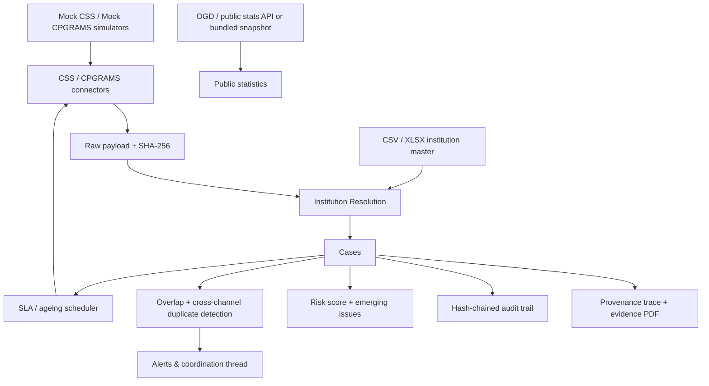

# AICTE Integrated Institution Complaint Monitoring Dashboard

Synthetic data is used for demo purposes (clearly labeled). This is an institution-centric intelligence layer over existing complaint channels.

## Architecture


## What is real vs simulated
| Capability | Data shown | Honesty rule |
|---|---|---|
| CSS feed | Mock CSS service with generated tickets | Badged `SIMULATOR – synthetic data`; never called live |
| CPGRAMS feed | Mock CPGRAMS service with a different payload format | Badged `SIMULATOR – synthetic data` |
| Institution master | Seeded synthetic institutions or uploaded CSV/XLSX | `SIMULATOR` / `FILE_UPLOAD` badges |
| Public statistics | Bundled snapshot unless `OGD_API_KEY`/URLs are configured | `SNAPSHOT` badge, dashboard proof summary shows mode |
| Risk score | Deterministic weighted score on stored cases | Every weight and raw value is shown; not a prediction |
| Emerging issues | Weekly z-score spike detector | Threshold and baseline are displayed; not a finding of wrongdoing |
| Impact simulator | Deterministic replay of stored cases | Explicitly “Model output, not a measured claim”; assumptions editable |

Complainant identifiers are never stored raw. Only a salted SHA-256 hash (`COMPLAINANT_HASH_SALT`) is retained.

## Quick Start (Docker)
```bash
cp .env.example .env
make up
make seed  # in another terminal after services are up
```

Frontend: http://localhost:5173  
Backend: http://localhost:8000/docs  
Mock CSS: http://localhost:8101/docs · Mock CPGRAMS: http://localhost:8102/docs

## Quick Start (local, no Docker)
```bash
cd backend
python -m pip install --user -r requirements.txt
PYTHONPATH=. python -m seed.seed_data
PYTHONPATH=. uvicorn app.main:app --host 127.0.0.1 --port 8000

# separate terminals, from repository root
cd mock_css && python -m uvicorn main:app --host 127.0.0.1 --port 8101
cd mock_cpgrams && python -m uvicorn main:app --host 127.0.0.1 --port 8102

cd frontend && npm install && npm run dev
```
When running outside Docker, set `CSS_BASE_URL=http://127.0.0.1:8101`, `CPGRAMS_BASE_URL=http://127.0.0.1:8102`, `CSS_ADMIN_URL=http://127.0.0.1:8101`, and `CPGRAMS_ADMIN_URL=http://127.0.0.1:8102` for the backend process. The scheduler syncs both simulators every 20 seconds.

## CPGRAMS educational demo integration
The separate `cpgrams-demo/` site is an explicitly unofficial educational replica. A grievance submitted there can be sent to this dashboard through the existing authenticated `POST /ingest/json` endpoint. Demo-origin cases are stored with `source_name=CPGRAMS Simulator`, `source_type=SIMULATOR`, `is_synthetic=true`, their subject and a raw-payload provenance record, so they appear in Case Tracking and dashboard totals with the correct `SIMULATOR` badge.

Run the demo locally against this dashboard:

```bash
cd cpgrams-demo
python -m app.seed
DASHBOARD_INGEST_URL=http://127.0.0.1:8000/ingest/json \
DASHBOARD_USERNAME=admin@aicte.gov.in \
DASHBOARD_PASSWORD=admin123 \
python -m uvicorn app.main:app --reload --port 8090
```

The demo caches the dashboard login and refreshes it after a `401`. Use a dedicated dashboard account outside local demo use; do not put a personal administrator password in a public deployment.

### Deployment
- Deploy `cpgrams-demo/` to Vercel as a FastAPI project with `CPGRAMS_DB_URL` pointing to a Turso/libSQL database. Vercel's local filesystem is ephemeral, so plain SQLite is not durable there.
- Deploy `frontend/` to Vercel as a Vite project and set `VITE_API_BASE_URL` to the public dashboard API URL.
- Run the dashboard backend on a container host with persistent PostgreSQL and a stable URL. Its scheduler and long-running database jobs are not suitable for a short-lived serverless function.
- Set the demo's `DASHBOARD_INGEST_URL`, `DASHBOARD_USERNAME`, and `DASHBOARD_PASSWORD` to the deployed dashboard values, then submit a test grievance and confirm it appears in Case Tracking as `SIMULATOR / CPGRAMS Simulator`.

See `cpgrams-demo/README.md` for the full environment-variable reference and Vercel steps.

## Part 2 features
- Connector architecture with YAML field mappings, canonical ticket model, date/category/language normalization, rate limiting, retries, file mode, and labelled snapshot fallback.
- Raw payload retention (immutable JSON + SHA-256) for every ingested record; idempotent re-sync by source + record ID.
- Four-stage provenance trace: raw payload → normalized record → institution resolution → overlap decision, plus audit-chain verification.
- Source badges throughout the UI and a Data Sources control room with sync-now, enable/disable, quality metrics, public-stat snapshots, raw-payload viewer, and SSE live feed.
- Cross-channel duplicate detection within a configurable window, with `CROSS_CHANNEL_DUPLICATE` links.
- Transparent institution risk score with per-component raw values, weights and points.
- Outcome tagging with a contradictory-outcome guard across linked cases; acknowledgement requires a mandatory remark.
- Emerging-issue spike detection by category/region, NL query parser with chips, and deterministic impact replay.
- Evidence-pack PDFs per overlap alert and institution brief PDFs.
- Language detection/translation hook with original + translated narrative display and multilingual labels.

## Part 3 features
- Realistic synthetic grievance narratives: 1,500+ multi-paragraph complaints across FEE, FACULTY, INFRASTRUCTURE, APPROVAL_VIOLATION, ACADEMIC_ADMINISTRATION, GOVERNANCE_MISCONDUCT and RAGGING_DISCRIMINATION.
- Four length buckets (SHORT/MEDIUM/LONG/ULTRA), English plus Hindi/Bengali/Tamil/Marathi/Telugu originals, complainant personas, masked identifiers, institutions, dates and document references.
- 3–12 step action lifecycles with bureau-specific remarks, hash-chained actions, document attachments, outcome tags, next actions and expected disposal dates.
- Deterministic, idempotent in-place reseed: existing case IDs, users, institutions and bureaus are preserved; `SEED_RANDOM_SEED` controls the corpus.
- Planted overlap clusters, ambiguous institution references, unresolved references and contradictory dispositions for demonstrations.
- Case Tracking/Case Detail expose subject, sub-type, complainant type, expandable narrative and a synthetic-data badge; overlap alerts highlight shared narrative tokens.
- Matching Evaluation compares five reproducible lexical matchers on a versioned 240-pair synthetic benchmark, with a group-safe development/test split.
- Case Detail shows similar resolved precedents as advisory context, with explicit outcome-conflict handling and audited helpful/not-useful/wrong-match feedback.
- Reseed without changing source or case IDs:
```bash
make reseed-realistic              # default seed 20261025
make reseed-realistic SEED=20261026
```

## Synthetic data design
- **Synthetic data is explicitly labelled.** Simulator sources and seeded cases set `is_synthetic=true`; the UI shows `SYNTHETIC DATA`.
- **No real PII.** Name pools and institutions are fictional. Phone/UIN/email values are masked, and restricted categories (ragging, harassment) avoid graphic detail.
- **Deterministic by default.** Institutions are assigned from `seed + case_id`, dates are anchored to UTC midnight, and all randomness is seeded. Re-running reseed produces identical cases, lifecycles and alerts.
- **Bounded and realistic.** Status/category/channel mixes follow weighted distributions; review cases are ~5%, unresolved references ~1.5%, and planted overlaps remain intact.
- **Honest provenance.** Rewritten cases keep their source channel and source name, but are marked synthetic. They are demo fixtures, not real complaints.

## Part 2 demo script
1. Login as `admin@aicte.gov.in` / `admin123`.
2. Open **Data Sources**. Confirm both feed cards say `SIMULATOR`; check quality, public-stat `SNAPSHOT`, raw payloads, and the live event feed. Click **Trigger demo scenario** to inject a cross-bureau overlap through the real pipeline.
3. Open **Dashboard**. Show the 24-hour source-proof banner, top-risk institutions, and the seeded fee-complaint spike.
4. Open **Emerging Issues**. Show the Southern/FEE spike, z-score and weekly sparkline.
5. Open **Case Tracking**, run the natural-language query `institutions with RB and PGRC overlap in southern region older than 60 days`, and inspect the parsed chips.
6. Open the hero case `PG-2026-4471`, click **View evidence trail**, then try tagging `DEFICIENCY_CONFIRMED` to trigger the conflicting-outcome warning (linked `RB-2026-0892` is `NO_DEFICIENCY`). Acknowledge with a remark.
7. Open **Overlap Alerts**, expand an alert, open a case trace, verify the audit chain, and download the evidence-pack PDF.
8. Open **Impact Simulator**. Change assumptions, confirm deterministic replay, and read the model-output disclaimer.
9. Open an institution, inspect the risk breakdown, and download the institution brief PDF.

## Demo Users (dev only)
| Email | Password | Role |
|---|---|---|
| admin@aicte.gov.in | admin123 | ADMIN |
| mgmt@aicte.gov.in | mgmt123 | MANAGEMENT |
| rb.officer@aicte.gov.in | rb123 | RB_OFFICER |
| pgrc.officer@aicte.gov.in | pgrc123 | PGRC_OFFICER |
| approval.officer@aicte.gov.in | approval123 | BUREAU_OFFICER |
| evc.officer@aicte.gov.in | evc123 | BUREAU_OFFICER |
| ro.chennai@aicte.gov.in | ro123 | REGIONAL_OFFICER |
| ro.bhopal@aicte.gov.in | ro123 | REGIONAL_OFFICER |
| ro.kolkata@aicte.gov.in | ro123 | REGIONAL_OFFICER |
| ro.pune@aicte.gov.in | ro123 | REGIONAL_OFFICER |
| ro.hyderabad@aicte.gov.in | ro123 | REGIONAL_OFFICER |
| ro.chandigarh@aicte.gov.in | ro123 | REGIONAL_OFFICER |

## Entity Resolution & Overlap (explain)
- **Resolution:** deterministic AICTE ID → normalization (abbrev/unidecode) → blocking → rapidfuzz token_set_ratio plus exact-name/alias phrase, address and city/state hints inferred from the raw ticket. `>=0.90` auto-link, `0.65-0.90` review queue, `<0.65` unresolved. Reviewer confirmations saved as aliases (learning). Prefer false negatives.
- **Overlap:** rule-first - if institution has active cases in >=2 bureaus → create overlap alert with "why flagged", cross-bureau links, notify officers. TF-IDF cosine similarity enriches near-duplicates. No auto-close; officers must acknowledge/review with reason. Unacknowledged alerts escalate to MANAGEMENT/ADMIN after `OVERLAP_ESCALATE_DAYS` with a distinct `ESCALATION` notification and an `ESCALATED TO MANAGEMENT` badge.
- **Resolution benchmark:** Resolution Review runs a deterministic offline harness (240 messy synthetic references, fixed seed) and shows precision/recall/F1, auto-link coverage and run timestamp.

## Matching benchmark & precedents (explain)
- **Dataset:** `backend/data/matching_benchmark_v1.json` contains 240 pairs drawn from 60 source groups. Labels are assigned by construction (`120 DUPLICATE`, `60 RELATED`, `60 UNRELATED`); there were no human annotators, adjudicators or inter-annotator agreement. The UI and API label this as a synthetic engineering benchmark, not an official accuracy claim.
- **Split:** source groups are kept together, with seed `20261025` and a 50/50 development/test split (120 pairs each). A runtime assertion rejects any source-group overlap.
- **Methods:** lexical Jaccard, word TF-IDF, character TF-IDF, fuzzy token-set and a hybrid lexical score. Thresholds are tuned on development data only and then applied unchanged to test data.
- **Semantic status:** a multilingual sentence-embedding method is listed as unavailable unless the model stack is installed. The API does not fabricate semantic metrics; the current fallback is lexical.
- **CLI:** from `backend/`:
```bash
python -m app.benchmarks.runner --json /tmp/matching.json --csv /tmp/matching.csv
```
or `make matching-benchmark` from the repository root.
- **API/UI:** `GET /matching/evaluation` returns methods, per-class metrics, confusion matrices, language groups, cross-language results, ablations, unavailable-method reasons and provenance. The Matching Evaluation page renders the same data and caches the evaluation.
- **Precedents:** `GET /cases/{id}/precedents` returns scoped, similar *resolved* cases for an open complaint. Results are advisory only (`automatic_action: false`), expose contradictory outcomes instead of suppressing them, and use the same server-side bureau/region scope rules as case access.
- **Feedback:** `POST /cases/{id}/precedents/{precedent_case_id}/feedback` stores one of `HELPFUL`, `NOT_HELPFUL` or `WRONG_MATCH` per user/precedent and writes a hash-chained audit action. Feedback is evidence about usefulness, not an instruction to adopt the precedent's outcome.
- **No automatic inference:** precedents never set, recommend or copy an outcome. They show recorded outcomes, similarity reasons and excerpts for human judgement.

## Core demo script (3 min)
1. Login as `admin@aicte.gov.in` / `admin123`. Dashboard shows KPIs, source proof, top-risk institutions, and the hero institution **St. Xavier Institute of Technology** (PGRC `PG-2026-4471` + RB `RB-2026-0892`).
2. Go to Overlap Alerts → expand an alert, view side-by-side cases, trace provenance, download the evidence pack, acknowledge.
3. Go to Case Tracking, use the NL query bar; open a case and show Institution 360 merged timeline across bureaus.
4. Go to Resolution Review - see the timestamped precision/recall/F1 benchmark and an ambiguous match; confirm to learn the alias.
5. Go to Matching Evaluation - show the synthetic-provenance warning, five-method comparison, language groups and semantic-method unavailable status.
6. Open an open case from Case Tracking - inspect the advisory precedents panel, contradictory-outcome warning and feedback controls.
7. Go to Data Import - upload `backend/sample_data/css_tickets.csv`, a JSON case batch, or an institution master CSV/XLSX.
8. Go to Reports - export bureau-wise/ageing/overlaps as CSV/XLSX/PDF (all 8 report types × 4 formats are verified).

## Configuration
Connector modes are controlled by `SOURCE_MODE_CSS` / `SOURCE_MODE_CPGRAMS` (`simulator`, `file`, `live`). Live connectors are read-only and fall back to bundled snapshots with visible `SNAPSHOT` / `STALE` state. Key settings are documented in `.env.example`; mappings live in `backend/config/*_mapping.yaml`.

## Tests
```bash
make backend-test      # connector, ingestion, lineage, risk, conflict, duplicate, spike, NL, impact and reseed tests
make frontend-build    # TypeScript + production build
```
The suite covers idempotent re-sync, raw payload retention, snapshot fallback, four-stage lineage, risk breakdown arithmetic, conflicting outcome acknowledgement, cross-channel duplicates, spike thresholds, NL parsing, deterministic impact replay, resolution precision/recall/F1, matching benchmark determinism and group isolation, semantic-unavailable honesty, precedent scope and outcome conflicts, audited precedent feedback, overlap escalation, institution-master GRC import, report export serialization, narrative validation and deterministic realistic reseeding.

## Assumptions
- Synthetic institutions/cases only; no PII from real systems.
- The realistic reseed mutates the local SQLite demo corpus in place; back up `backend/aicte.db` before experimenting with a new seed.
- CSS/CPGRAMS formats vary - mappings are external YAML, not hardcoded.
- Live public endpoints may be unavailable; snapshots are used and labelled as such.
- Overlap near-duplicate scoring uses TF-IDF, not sentence embeddings. This is a deliberate demo choice: it runs offline and deterministically without downloading model weights, needs no GPU, works on the SQLite corpus, and exposes token-level overlap that officers can inspect. The rule-based cross-bureau trigger remains authoritative; TF-IDF only enriches near-duplicate links. Sentence embeddings would add a model artifact, latency and opaque similarity, so they are not enabled in this build.
- Regional scoping enforced server-side; sensitive narratives are masked for non-owning bureaus.

## Limitations & Next Steps
- Graph DB for complex link analysis
- Real CSS/CPGRAMS API integration with OAuth/webhooks
- Sentence embeddings upgrade with vector store
- SSO/SAML, fine-grained field-level masking, e-signatures
- Workflow engine for SLAs/escalations with configurable rules
# Reva-dashboard
